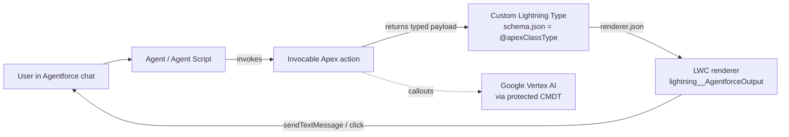

# Agentforce UI Kit

A gallery of rich-UI components for Agentforce chat: Lightning Web Components paired with Custom Lightning Types, each fed by an invocable Apex action.

## What it does

Agentforce actions normally return plain text. In this kit, each action returns a typed Apex payload, a Custom Lightning Type binds that payload to an LWC renderer, and the agent chat then shows a card, carousel, selector, uploader or try-on widget instead of text. Where a component needs to answer back (pick an option, say yes/no), it sends the choice into the conversation as a chat message.

Highlights, all taken from the code in this repo:

- Option selectors (several visual variants), yes/no prompts, a service-request picker and an employee action picker.
- Product carousels, product cards, product comparison dashboard, dealer cards and address lists with map links.
- File upload, video message, secure one-time link card, customer-query card and holiday-greeting template picker.
- Virtual try-on widgets backed by Google Vertex AI (Imagen) and a tyre-defect analysis flow that attaches a warranty PDF to a Case.
- Chat chrome: custom chat header and a promo popup.
- One example Agent Script (`Brightwave_Agent`) showing how the actions are wired into an agent.

"Brightwave" is the fictional brand used in the examples. All data, images and names are placeholders.

## Architecture



Pairing rules (each type follows them):

1. `lightningTypes/<type>/schema.json` has `"lightning:type": "@apexClassType/c__<ApexClass>"`.
2. `lightningTypes/<type>/enhancedWebChat/renderer.json` (and often `lightningDesktopGenAi/renderer.json`) points at `c/<lwc>`.
3. The LWC meta file declares `<sourceType name="c__<type>"/>` under target `lightning__AgentforceOutput`.

## Component gallery

| LWC | Lightning Type | Apex payload class | What it renders |
|---|---|---|---|
| `agentDeCardWithData` | `de_card_with_data` | `de_CardWithDataInfo` | Product detail card: image, description, size, features |
| `agentDeCustomerQuery` | `de_CustomerQuery` | `de_CustomerQueryInfo` | Echo card of the customer's question |
| `agentDeDealerAddress` | `de_dealer_address` | `de_DealerAddressInfo` | Nearby dealer addresses with map links |
| `agentDeOptionsSelection` | `de_OptionsSelection` | `DeOptionsSelectionInfo` | Basic selectable options (V1) |
| `agentDeOptionsSelectionV2` | `de_OptionsSelection_v2` | `DeOptionsSelectionInfoV2` | Card-style selectable options with icons (V2) |
| `agentDeOptionsSelectionV3` | `de_OptionsSelection_v3` | `DeOptionsSelectionInfoV3` | Selection cards with a recommended pick (V3) |
| `agentDeOptionsSelectionBw` | `de_OptionsSelection_bw` | `de_OptionsSelectionInfoBw` | Riding-style / usage options for the tyre scenario |
| `agentDePromptAction` | `de_prompt_action` | `de_PromptActionController` | Answer from a prompt template (RAG-style Q&A) |
| `agentDeScriptOptionSelection` | `de_script_option_selection` | `de_ScriptOptionSelectionController` | Options driven from an agent script |
| `agentDeSecureLink` | `de_secureLink` | `DeSecureLinkInfo` | Clickable secure one-time link card |
| `agentDeServReq` | `de_ServReq` | `de_ServReqInfo` | Service-request option picker |
| `agentDeStringOutput` | `de_StringOutput` | `DeStringOutputInfo` | Styled plain-string output |
| `agentDeTyreDefectBw` | `de_tyre_defect_bw` | `de_TyreDefectInfoBw` | Tyre defect analysis result and warranty voucher |
| `agentDeYesNo` | `de_yes_no` | `de_YesNoInfo` | Yes/No prompt that replies into the chat |
| `agentDeYesNoDealer` | `de_yes_no_dealer` | `de_YesNoDealerInfo` | Yes/No prompt: "find a dealer nearby?" |
| `agentFileUpload` | `fileUploadResponse` | `FileUploadInfo` | File uploader |
| `asaCarousel` | `asaCarousel` | `AsaCarouselData` | Product carousel (title, image, description) |
| `asaItemSelector` | `asaItemSelector` | `AsaItemSelectorData` | Single/multi-select item picker |
| `de_asaCarousel` | `de_asaCarousel` | `de_AsaCarouselData` | Product carousel (variant) |
| `de_ASACarousel_Saree` | `de_ASACarousel_Saree` | `de_ASACarouselSareeData` | Apparel carousel (variant) |
| `deHtmlEmployeeAgent` | `de_HTML_Employee_Agent` | `DeHtmlEmployeeAgentInfo` | Product comparison dashboard (HTML) |
| `de_product_comparison` | `de_product_comparison` | `de_ProductComparisonData` | Side-by-side product comparison card |
| `de_employeeActionSelector` | `de_employeeActionSelector` | `de_EmployeeActionSelectorInfo` | Employee action picker |
| `de_virtual_try_on_creative_agent` | `de_VirtualTryOn_Creative` | `de_VirtualTryOnCreativeInfo` | Virtual try-on, creative generation |
| `de_virtual_try_on_dress_agent` | `de_VirtualTryOn_Dress` | `de_VirtualTryOnDressInfo` | Virtual try-on for a carousel item |
| `de_bwDealerCard` | `de_bwDealerCard` | `de_BW_ShowDealerCards` | Dealer details card |
| `de_bwOptionSelector` | `de_bwOptionSelector` | `de_BW_ShowOptions` | Option selector for the tyre scenario |
| `de_bwTyreRecommendationCard` | `de_bwTyreRecommendationCard` | `de_BW_ShowTyreCard` | Tyre recommendation card |
| `holidayTemplateSelector` | `HolidayTemplateSelector` | `TemplateData` | Greeting template picker (generated image via callout) |
| `videoMessage` | `videoMessage` | `VideoMessageInfo` | Video message output |

LWCs without a Lightning Type (used as chrome or demos):

| LWC | Purpose |
|---|---|
| `de_custom_chat_header` | Custom header for the enhanced web chat |
| `de_chatPromoPopup` | Promo popup shown over the chat |
| `audioRecorder` | Browser speech-recognition recorder |
| `de_mock_file_analysis_agent` | Mock AI file-analysis dossier with canned results |
| `de_google_image_gen_VirtualTryOn_Creative` | Standalone Imagen try-on UI for App/Record/Home pages |

### Versioned duplicates (kept on purpose)

`agentDeOptionsSelection`, `...V2` and `...V3` (with their Apex classes and Lightning Types) are not merged. They differ in visuals and payload shape (V1 plain, V2 icon cards, V3 cards with a recommendation), and each Lightning Type binds to its own Apex class, so merging would change contracts. Treat them as three styles to pick from.

## Prerequisites

- Salesforce CLI (`sf`) and a Dev Hub or sandbox/scratch org with Agentforce and Einstein enabled.
- Enhanced web chat (Messaging for In-App and Web) if you want the `enhancedWebChat` renderers.
- Node.js 18+ only if you want lint/Jest (`npm install`).
- A Google Cloud project with Vertex AI enabled, only for the try-on features.

## Setup and deploy

```bash
sf org login web --alias my-org
sf project deploy start --source-dir force-app --target-org my-org
sf org assign permset --name Agentforce_UI_Kit_Access --target-org my-org
```

Then attach the invocable actions to your agent (topic actions), or deploy the example agent in `aiAuthoringBundles/Brightwave_Agent`.

## Configuration

| Item | Where | What to set |
|---|---|---|
| Google service account | Custom Metadata `Google_Service_Account.Default` (protected type `Google_Service_Account__mdt`) | Set `Client_Email__c`, `Project_Id__c`, `Private_Key__c` from your own service-account JSON. Committed values are `REPLACE_ME`; the auth class throws a clear error until you change them. Never commit real values. |
| Remote site / Named Credential | Setup | Allow `https://oauth2.googleapis.com` and your Vertex AI region host for the try-on callouts. |
| Agent user | `Brightwave_Agent.agent` `default_agent_user` | Replace `REPLACE_ME@example.com` with a real agent user in your org. |
| Prompt template and Data Cloud index | `de_PromptActionController`, `de_VectorSearchService` | Reference `Brightwave_Web_Crawler_Prompt` and `Brightwave_Web_Crawler_*` DLOs. Create your own or edit the names. |
| Site / link URLs | `DeSecureLinkAction`, `de_DealerAddressAction` and similar | Placeholder URLs; point them at your own site. |
| Static resources | `staticresources/` | Generated placeholder images; swap in your own artwork. |

## Screenshots

Add screenshots to `docs/screenshots/` (PNG, about 1200px wide) and link them here.

## License

MIT. See [LICENSE](LICENSE).
